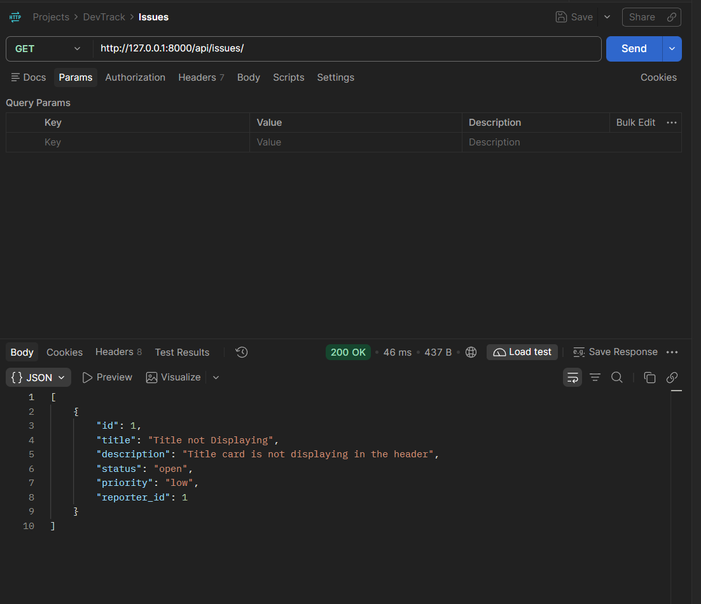

# DevTrack – Issue Tracking API

DevTrack is a Django-based REST API designed to track and manage software bugs and issues.

It allows developers and testers to log issues, track their status, assign priorities, and maintain reporter information.

## 1. Features

- Create and retrieve issues.
- Retrieve individual issues using their unique ID.
- Filter issues based on their status.
- Assign priorities to issues.
- Create and retrieve reporter information.
- Validate issue and reporter data.
- Return appropriate HTTP responses for successful and failed requests.

## 2. Installation and Setup

### Prerequisites

- Python 3.x
- pip
- Git

### Clone the Repository

```bash
git clone https://github.com/<your-username>/devTrack.git
cd devTrack
```

### Install Dependencies

```bash
pip install -r requirements.txt
```

### Start the Development Server

```bash
python manage.py runserver
```

The application will run at:

`http://127.0.0.1:8000/`

## 3. API Endpoints

### Issues API

The Issues API allows users to create, retrieve, and filter issues.

| Method | Endpoint | Description |
|---|---|---|
| GET | `/api/issues/` | Retrieve all issues |
| GET | `/api/issues/<issue_id>/` | Retrieve an issue by ID |
| POST | `/api/issues/` | Create a new issue |
| GET | `/api/issues/<status>/` | Retrieve issues by status |

#### 3.1 Get All Issues

**Endpoint:** `GET /api/issues/`

Retrieves all issues available in the system.



#### 3.2 Get Issue by ID

**Endpoint:** `GET /api/issues/1/`

Retrieves a specific issue using its unique ID.

**Success Response:** Returns the requested issue when the ID exists.


**Failure Response:** Returns an error when the requested issue ID does not exist.


#### 3.3 Create Issue

**Endpoint:** `POST /api/issues/`

Creates a new issue with the provided details, such as title, status, and priority.

**Success Response:** Issue is successfully created when the submitted data is valid.


**Failure Response:** Returns a validation error when the submitted data is invalid or the issue ID already exists.


#### 3.4 Get Issues by Status

**Endpoint:** `GET /api/issues/open/`

Filters and retrieves issues based on their current status.

**Success Response:** Returns issues matching the requested status.


**Failure Response:** Shows the error response for an invalid or unsupported status.


---

### Reporters API

The Reporters API manages information about users who report issues.

| Method | Endpoint | Description |
|---|---|---|
| GET | `/api/reporters/` | Retrieve all reporters |
| GET | `/api/reporters/<reporter_id>/` | Retrieve a reporter by ID |
| POST | `/api/reporters/` | Create a new reporter |

#### 3.5 Get All Reporters

**Endpoint:** `GET /api/reporters/`

Retrieves all registered reporters.


#### 3.6 Get Reporter by ID

**Endpoint:** `GET /api/reporters/1/`

Retrieves information about a specific reporter.

**Success Response:** Returns the reporter details when the ID exists.


**Failure Response:** Returns an error when the reporter ID does not exist.


#### 3.7 Create Reporter

**Endpoint:** `POST /api/reporters/`

Creates a new reporter using the submitted information.

**Success Response:** Reporter is created successfully when valid data is provided.


**Failure Response:** Returns a validation error when the submitted information is invalid.


## 4. Design Decision

### Separating Data Validation from Request Handling

One important design decision in DevTrack is to keep data validation within the model layer instead of implementing all validation logic directly in the views.

**Why this approach?**

- **Separation of concerns:** Views handle HTTP requests and responses, while models handle data validation.
- **Reusability:** Validation logic can be reused across multiple endpoints.
- **Maintainability:** Changes to validation rules can be made without modifying request-handling logic.
- **Data integrity:** Helps prevent invalid or duplicate issue records from being stored.

This approach keeps the code organized, readable, and easier to maintain as the application grows.

## 5. Technologies Used

- **Python** – Core programming language
- **Django** – Backend web framework
- **Django URL Routing** – API endpoint routing
- **Postman** – API testing and validation
- **Git & GitHub** – Version control and source code management

## 6. Future Enhancements

- Update and delete existing issues.
- Assign issues to developers.
- Add authentication and authorization.
- Introduce pagination and advanced filtering.
- Integrate a relational database for persistent storage.

---

**DevTrack – Simplifying Bug Tracking and Issue Management.**